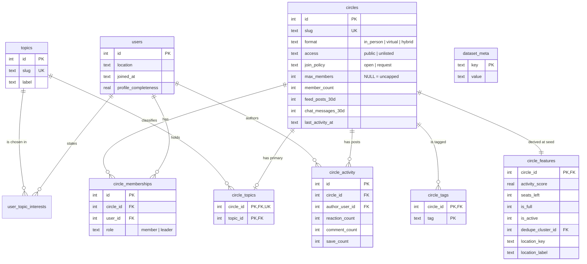

# Schema

`schema.sql` is the single source of truth. `make seed` rebuilds the database from scratch: it builds a new
database in a temporary file next to `data/app.db` and then atomically replaces the old one. Running it twice
gives identical contents (`tests/test_seed.py` checks this), and a failed seed never leaves a half-written
database behind.

## Entity relationships

## Design reasoning

- **Normalised, but only as far as the data goes.** Interests, primary topics, tags and memberships are
  their own tables because they are many-to-many or optional. There are no `networks` / `user_networks`
  tables: the dataset has no Network data (see `DATA_NOTES.md` §9), and empty tables would imply a signal
  the system does not use.
- **`circle_topics` holds the primary topic only** (`UNIQUE (circle_id)`), and **`circle_tags` holds tags
  as free text**. The data dictionary calls tags "free-form", so they are not foreign keys to `topics`,
  even though every tag in this snapshot happens to be a valid slug. The composite primary key de-duplicates
  Circle 17's repeated tag.
- **`circle_features` is derived once at seed time.** Activity score, `is_full`, `is_active`, seats left,
  dedupe cluster and the leader-derived location change slowly while recommendation reads are frequent, so
  they are computed once and read on every request. In production they would be refreshed by membership
  and activity events (see `DESIGN.md`).
- **`dataset_meta.reference_time`** stores the clock all recency maths used, so request-time code (new-member
  detection) uses the same "now" as the seed-time features.
- **Constraints**: every enum is a `CHECK`, counts are non-negative, `profile_completeness` and
  `activity_score` are bounded to [0, 1], `max_members` must be positive when present, `location_key` and
  `location_label` are null together. Foreign keys are enforced during seeding and verified with
  `PRAGMA foreign_key_check`.
- **Timestamps are ISO-8601 text**, the idiomatic SQLite choice; they sort correctly as strings.
- **The API opens the database read-only** (`mode=ro`), one connection per request.

## Indexes

| Index | Serves | Why |
| --- | --- | --- |
| `circle_memberships (user_id)` | "Which Circles is this member in?" (candidate exclusion, implied interests, joined clusters) | Runs on every request; without it, a full scan of memberships. |
| `UNIQUE circle_memberships (circle_id, user_id)` | Integrity, and "who is in this Circle?" | A member cannot join the same Circle twice. At join time this is also the guard against double-joins. |
| `user_topic_interests` primary key `(user_id, topic_id)` | "What did this member say they care about?" | The table is `WITHOUT ROWID`, so the primary key *is* the clustered index on `user_id`. A separate `(user_id)` index, as originally planned, would be redundant, so it was left out. |
| `circle_topics (topic_id, circle_id)` | "Which Circles cover topic X?" | The reverse of the primary key. At 40 Circles every request reads all Circles anyway; this index is what topic-first candidate generation would use once the catalogue is too large to score in full. It is the one index here kept for scale, not for a current query. |
| `circle_features (is_active, is_full)` | Candidate generation for normal requests | Normal requests fetch only Circles with `is_active = 1 AND is_full = 0` (plus `access = 'public'`). Debug requests load every Circle so they can report why each one was filtered; a test confirms both paths return identical rankings. |

No index on `circle_activity (circle_id)`: activity is only aggregated once, at seed time, as a full scan.
